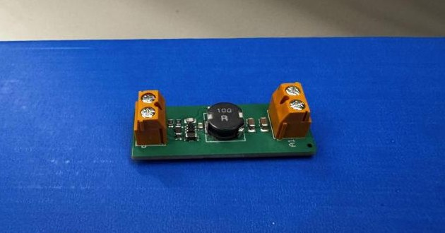
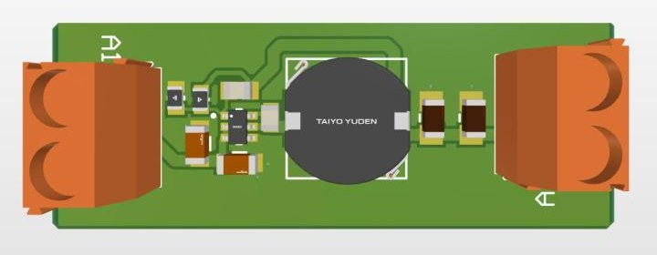
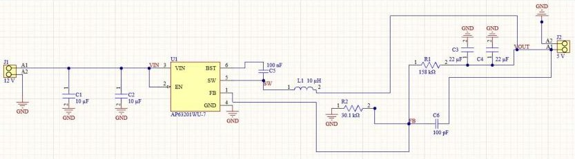
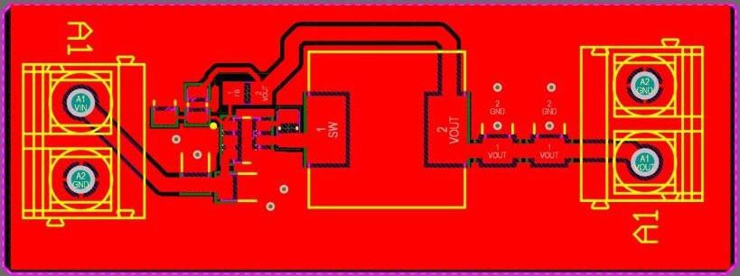
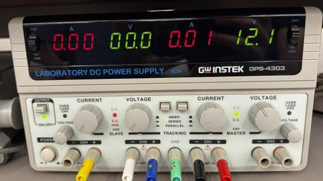

# AP63201 12 V-to-5 V, 2 A Buck Converter

A synchronous buck converter PCB built around the Diodes Inc. **AP63201WU-7**: designed in Altium Designer, fabricated and assembled by JLCPCB, then hand-finished and bench-tested.

**Status (Nov 2026):** fabricated and powered up. No-load regulation is measured on two boards. Load, efficiency, ripple and temperature tests are next ([test plan](test-plan.md)).

| Assembled board | Altium 3D render |
|---|---|
|  |  |

---

## Specs at a glance

`calc` = design calculation · `meas` = measured on the bench

| Parameter | Value | Source |
|---|---|---|
| Input | 12 V nominal (tested 8.2–12.1 V) | — |
| Output target | 5 V, 2 A | calc |
| Switching frequency | 500 kHz (AP63201 fixed) | datasheet |
| Feedback divider | 158 kΩ / 30.1 kΩ → 4.999 V | calc |
| Inductor | 10 µH (Taiyo Yuden NR10050T100M) | — |
| Inductor ripple | ≈ 0.58 A peak-to-peak at 12 V in | calc |
| IC temperature rise | ≈ 45 °C estimate at full load | calc |
| Output, no load | 5.0188–5.023 V (both boards) | meas |
| Setpoint error | ≈ +0.4 % vs 4.999 V design | meas |
| Line regulation, no load | within ≈ 2 mV across 8.2–12.1 V in | meas |
| Input current, no load | ≈ 0.01 A at 12.1 V | meas |

## Design



**Output voltage.** The AP63201 regulates its FB pin to 0.8 V:

```
Vout = Vref × (1 + R1/R2) = 0.8 V × (1 + 158 kΩ / 30.1 kΩ) = 4.999 V
```

**Inductor ripple.** With Vin = 12 V, Vout = 5 V, L = 10 µH and f = 500 kHz:

```
ΔI_L = Vout × (Vin − Vout) / (Vin × L × f)
     = 5 × 7 / (12 × 10 µH × 500 kHz)
     ≈ 0.58 A peak-to-peak   (about 29 % of the 2 A load)
```

**Other parts (from the schematic):** 2 × 10 µF input capacitors, 2 × 22 µF output capacitors, a 100 nF bootstrap capacitor (BST to SW), and 100 pF across the top feedback resistor. EN is tied to VIN, so the converter starts whenever input is applied.

## Layout



- 2-layer board in Altium Designer.
- Input capacitor placed right at the IC to keep the high-current input loop small.
- Short switch-node (SW) copper to limit the noisy, fast-switching area.
- Ground plane with stitching vias.
- Screw terminals: **J1** input (top +12 V, bottom GND), **J2** output (top GND, bottom +5 V). The board has no terminal labels, so this mapping matters when wiring it up.
- Ran DRC and built the BOM before ordering.

## Build

- Ordered from JLCPCB (Nov 2026): 5 boards, 2 of them assembled. The inductor and screw terminals were ordered separately from DigiKey.
- Hand-soldered the inductor with hot air, flux and solder paste, and soldered the screw terminals on both assembled boards.

## Bring-up

The first power-ups read about **10.9 V** on the output instead of 5 V.

- I checked the board with continuity and resistance measurements on a DMM and traced the problem to **terminal solder joints that weren't secure**.
- I reworked the joints and corrected the bench supply setup (current limit).
- After that, both boards regulated at about 5.02 V.

## Results so far (no load)

Measured on a 5½-digit Agilent 34405A DMM, with a GW Instek GPS-4303 bench supply.

| Measurement | Result |
|---|---|
| Output voltage, both boards | 5.0188–5.023 V |
| Output change across 8.2–12.1 V input | within ≈ 2 mV |
| Input current at 12.1 V | ≈ 0.01 A |



**Not yet measured:** efficiency, output ripple, load regulation and temperature. I'm not making any claims about these until they're measured. See the [test plan](test-plan.md).

## Tools

Altium Designer · JLCPCB fabrication and assembly · hot-air rework · Agilent 34405A DMM · GW Instek GPS-4303 bench supply · Rohde & Schwarz RTC1002 oscilloscope (for the ripple tests)

---

Part of my engineering portfolio: **[adeebtarzi.github.io](https://adeebtarzi.github.io)**
